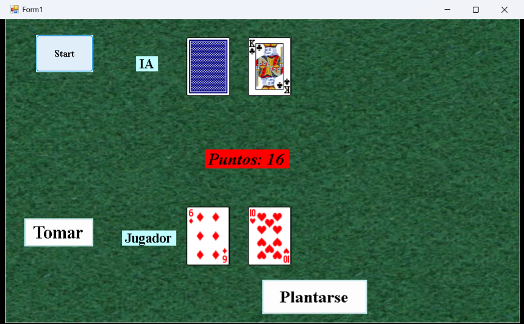
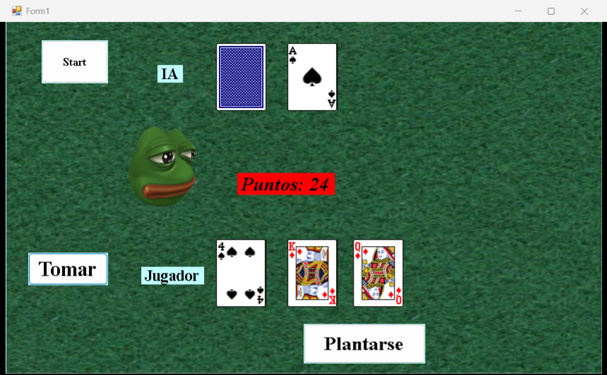

<h1 align="center">🃏 Blackjack 21</h1>

  El clásico juego de cartas <b>21</b> contra la computadora, hecho en C# con Windows Forms.

  
  
  

  
  &nbsp;
  

## 🎮 Cómo se juega

1. Presiona **Start**: se reparten dos cartas para ti y dos para la IA (una queda boca abajo).
2. **Tomar** te da otra carta. Si pasas de 21, pierdes.
3. **Plantarse** termina tu turno: la IA toma cartas hasta llegar al menos a 17 y gana quien quede más cerca de 21 sin pasarse.

## ✨ Detalles

- 🂡 Baraja completa de 52 cartas, barajada al azar en cada partida
- 🅰️ El **As vale 11 o 1** según convenga para no pasarse
- 🤖 La IA sigue la regla del crupier: pide carta mientras tenga menos de 17
- 🎉 Animación de victoria o derrota al terminar

## 🚀 Cómo correrlo

Abre `Juegos de cartas 21.sln` en **Visual Studio** y ejecuta con <kbd>F5</kbd>. Las imágenes de las cartas se copian solas junto al `.exe`.

---

Hecho por <a href="https://github.com/hermes2324">Hermes Verdugo</a> · TecNM Campus Guasave

